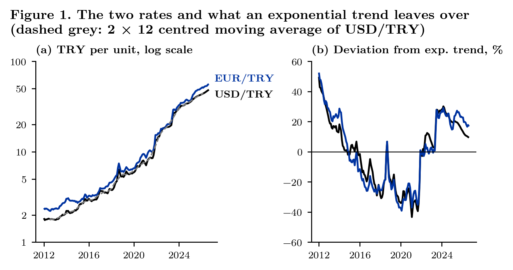
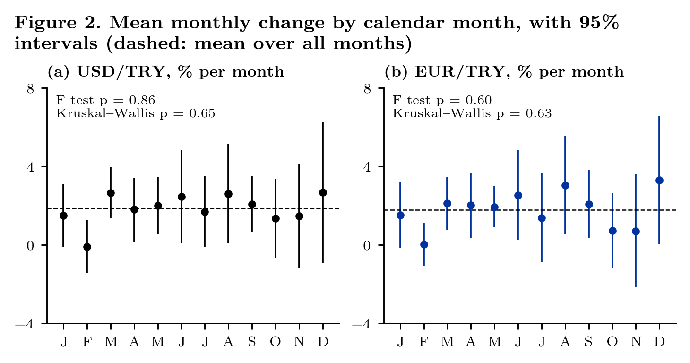
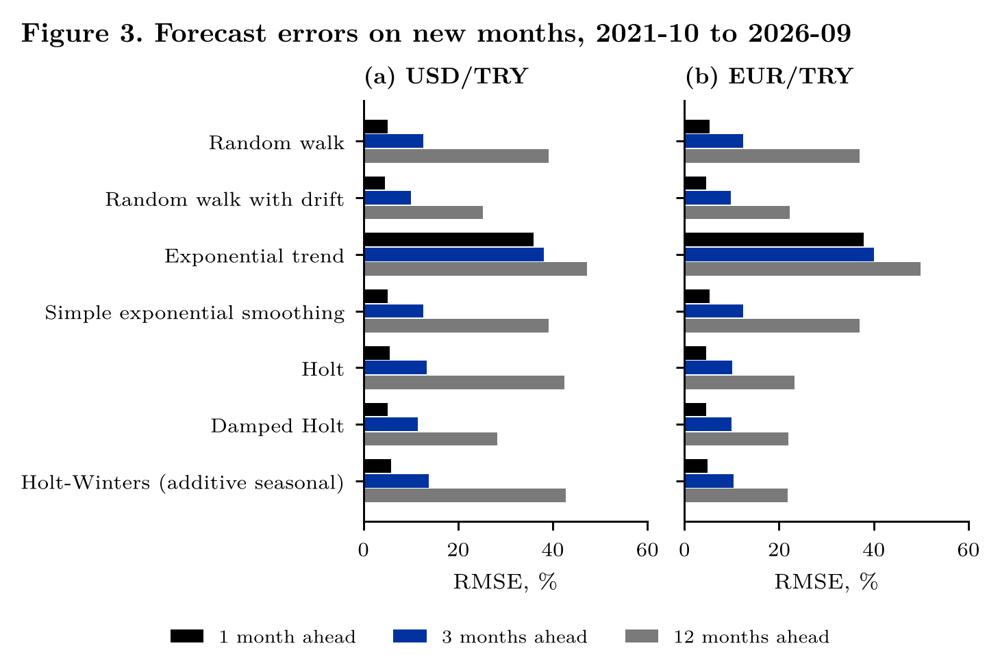

# The Trend of USD/TRY and EUR/TRY

[](https://github.com/mikbalyilmaz/USD_Exp_MA_TrendAnalysis/actions/workflows/tests.yml)

Version 2 of a time-series exercise from an undergraduate course week on trend analysis: moving averages, an
exponential trend and exponential smoothing, applied to the monthly USD/TRY and EUR/TRY rates of the CBRT,
January 2012 to September 2026 (177 months). Version 1 fitted the trend and judged it by eye and by $R^2$.
Version 2 asks whether the trend estimate leaves only noise, whether there is a seasonal pattern, and which method
forecasts months it was not fitted on. A short project note, [`paper/usd_note.pdf`](paper/usd_note.pdf), writes out
the equations and the results.

## Data

Monthly averages of the CBRT indicative buying and selling rates from EVDS (TP.DK.USD.A.YTL, TP.DK.USD.S.YTL,
TP.DK.EUR.A.YTL, TP.DK.EUR.S.YTL), downloaded on 26 October 2026: `data/usd_eur_evds_2012_2026.csv`. As in version 1,
the rate is the mean of the buying and the selling rate. USD/TRY rose from 1.84 to 48.56 (a factor of 26.3), EUR/TRY
from 2.38 to 55.96 (23.5); the mean monthly change was 1.86% and 1.79%. The file of version 1 is kept unchanged as
`data/usd_eur_v1.xlsx`.

## Results

**The trend is stochastic.** An exponential trend, $100\log(\text{rate}_t) = a + bt + u_t$, fits with $R^2$ = 0.960
(USD) and 0.950 (EUR), but its residuals stay on one side of the line for years (Durbin–Watson 0.033 and 0.029), and the
ADF test does not reject a unit root around a linear trend ($p$ = 0.46 and 0.52).

**Figure 1.** (a) The two rates, log scale; dashed grey: 2 × 12 centred moving average of USD/TRY. (b) Deviation from
the exponential trend, per cent.



**There is no monthly seasonality.** The monthly change does not differ by calendar month: F test of 11 month dummies
$p$ = 0.86 (USD) and 0.60 (EUR), Kruskal–Wallis $p$ = 0.65 and 0.63.

**Figure 2.** Mean monthly change in each calendar month, with 95% intervals; dashed: mean over all months.



**On new months the random walk with drift is hard to beat.** Each month from 2021-10 to 2026-09, every method was
fitted on the earlier months only and forecast 1, 3 and 12 months ahead. Root mean squared error, per cent:

| Method | USD 1 m | USD 3 m | USD 12 m | EUR 1 m | EUR 3 m | EUR 12 m |
|---|---|---|---|---|---|---|
| Random walk | 5.2 | 12.6 | 39.2 | 5.3 | 12.4 | 37.0 |
| Random walk with drift | 4.5 | 10.1 | 25.2 | 4.6 | 9.9 | 22.3 |
| Exponential trend | 36.0 | 38.1 | 47.3 | 37.9 | 40.1 | 49.9 |
| Simple exponential smoothing | 5.2 | 12.6 | 39.2 | 5.3 | 12.4 | 37.0 |
| Holt | 5.5 | 13.4 | 42.4 | 4.7 | 10.2 | 23.3 |
| Damped Holt | 5.2 | 11.6 | 28.2 | 4.6 | 9.9 | 21.9 |
| Holt–Winters (additive seasonal) | 5.8 | 13.8 | 42.7 | 4.9 | 10.4 | 21.8 |

The exponential trend has the largest errors at every horizon. Simple exponential smoothing equals the random walk,
because its fitted smoothing weight is 1. For USD the drift is the most accurate at every horizon; for EUR damped Holt
and Holt–Winters are within half a point of it.

**Figure 3.** Forecast errors on new months, by method and horizon.



All numbers are in `figures/*.csv` and in the project note.

## Contents

| Path | What it is |
|---|---|
| `usdtrend/data.py` | Loads and checks the data; basket rate; version 1's file |
| `usdtrend/methods.py` | Centred and trailing moving averages, exponential trend, month-effect tests, forecasting methods, expanding-window evaluation |
| `usdtrend/style.py` | Figure style (Latin Modern Roman, colours and axis rule of muhammedikbalyilmaz.com); checks every figure before saving it |
| `tests/run_tests.py` | Unit tests against written-out formulas, other library functions and the printed output of version 1 |
| `analysis/01_trend.py` | Data, moving averages, exponential trend, ADF (Figure 1) |
| `analysis/02_seasonality.py` | Month effects (Figure 2) |
| `analysis/03_forecast.py` | Out-of-sample comparison of the forecasting methods (Figure 3) |
| `analysis/run_all.py` | Runs the three analyses (about one minute) |
| `paper/` | Project note; `make_paper.py` writes its numbers from `figures/*.csv` |
| `legacy/` | Version 1, unchanged |
| `fonts/` | Latin Modern Roman (GUST Font License) |

## How to run

```
pip install -r requirements.txt
python tests/run_tests.py
cd analysis && python run_all.py
cd ../paper && python make_paper.py && xelatex usd_note.tex && xelatex usd_note.tex
```

## Changes from version 1

See [NEWS.md](NEWS.md).

## Citation

See [CITATION.cff](CITATION.cff).

## License

See [LICENSE](LICENSE).
